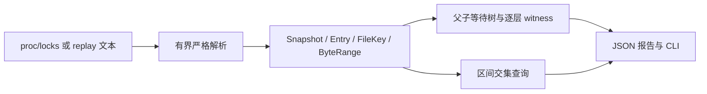

# MoonLockLens

0.4.0 扩展文件入口、同任务处理前后会话比较及 CI/定时任务阈值检查。面向构建缓存、批处理重叠、多进程争用、故障转交和工具集成；操作见 docs/scenarios.md，真实验证见 docs/test-evidence/scope-stage.md。

0.3.0 已扩展为 Linux 任务等待与文件争用诊断：从根任务 PID 进入，查看当前后代、锁请求和外部阻塞者；连续采样记录等待消失、状态或阻塞证据变化；保存会话后跨平台生成文本/JSON/Markdown。进程身份、证据缺失和采样边界在纯 MoonBit 核心中处理。流程见 docs/task-guide.md，验证见 docs/test-evidence/task-stage.md。该阶段扩展排查任务的完整流程，不宣称证明所有 CPU/I/O/网络等待根因。下文保留原有 MVP 的设计依据。

0.2.0 已补齐实际使用流程：免编译 Node 运行包、默认文本/显式 JSON、PID/实际文件/等待筛选、阻塞者上下文、stdin/BOM、独占现场保存和离线回放、自动化等待退出码。保留库兼容性，新增 matching/with_blockers。运行说明见 docs/cli-guide.md，续验见 docs/test-evidence/usability.md。

一个为 MoonBit 生态提供 Linux 文件锁等待关系解释与离线重放能力的开源项目。

目标用户：构建缓存、数据库运维、任务调度与容器诊断工具开发者。程序卡住时，需要知道哪个文件的哪个字节区间、哪条锁等待链在阻塞。lslocks 可人工查看，但 MoonBit 工具还需要可组合的类型化库。调研依据见两份生态报告。

原创实现。已有 POSIX 库负责取得锁，lslocks 是成熟外部工具；本项目新增纯 MoonBit `/proc/locks` 模型、保留未知类型与 lease 状态、缩进阻塞树、按行号解释等待链、直接/传递影响统计及 inode 字节区间查询。OFD PID -1 和 namespace 不可见 PID 0 明确为未知进程。

根包拥有公开类型，内部数组不向调用方暴露。cmd/main 为 Node.js 参数/文件读取适配；examples/demo 可在 Wasm-GC 与 JS 跑 synthetic。无第三方运行依赖。Windows 验证离线核心，Linux 验证 JS 实际采集与独立 Python fcntl/lslocks 对照。

MVP：POSIX/FLOCK/OFDLCK/LEASE/未知类型；十六进制 device、UInt64 inode、Int64 区间和 EOF；有界输入、数字溢出、缩进跳层/孤儿/重复根拒绝；实际父行索引与等待链；bottleneck 排序、range queries；JSON CLI；必要测试、真实竞争演示、包消费、文档与一页申报。

边界：只观察，不取得/释放用户锁，不杀持有者；快照不是事件订阅，行序号不是稳定身份，不能跨快照拼接；不扫描全机 fd/私有路径，不把 OFD 归给一个 PID；等待树不等于死锁证明；区间重叠不等于一定冲突（锁族、模式、owner、文件系统语义仍影响授予）；不证明所有阻塞原因可见。Linux 格式兼容边界明确报错，不默默给错误父节点。未来可研究按授权目录关联 fdinfo，不属本次。

维护：公开 API 按版本变更；解析失败与 oracle 发现差异进入回归；使用真实时间本地提交，不补造公开开发记录。

三分钟演示：0-30 秒展示 synthetic 两层等待；30-90 秒调用 wait_chain 和 bottlenecks；90-150 秒在独立临时文件上真实 POSIX/FLOCK/OFD 竞争并与 lslocks 对照；150-180 秒展示未知 PID 与拒绝坏缩进，解释范围与生态价值。
